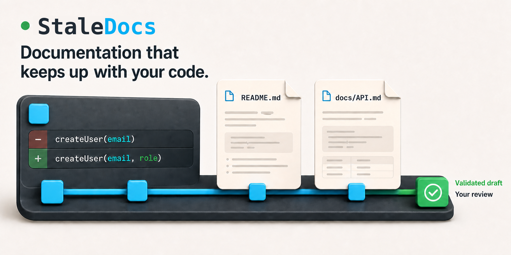
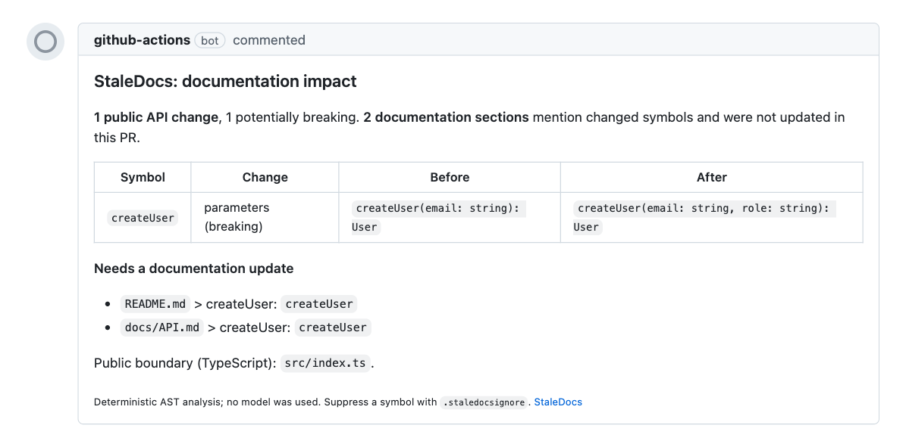

# StaleDocs

Formerly aidoc.

<p align="center">
  
</p>

StaleDocs reads your code, finds public API changes in a pull request, and tells you which documentation sections now describe the old behavior.

[Website](https://staledocs.com) · [GitHub Action setup](./docs/GITHUB_ACTION.md) · [Codex plugin](#codex-plugin)

## Add to a repository in one file

```yaml
name: StaleDocs review
on: {pull_request: {types: [opened, synchronize, reopened]}}
permissions: {contents: read, pull-requests: write}
jobs:
  review:
    runs-on: ubuntu-latest
    steps:
      - uses: actions/checkout@3d3c42e5aac5ba805825da76410c181273ba90b1
        with: {fetch-depth: 0}
      - uses: mr-min-max/staledocs@v0.5.0-beta.1
        with:
          mode: review
          fail-on: none
```



## What the comment contains

- Changed symbols with before and after signatures.
- Sections that mention them and were not updated.
- `breaking-change` and `docs-stale` labels when applicable.

No model, no API key, no writes. It is deterministic AST analysis.

## From the terminal

Install the command:

```bash
npm install -g staledocs
```

`staledocs review` reports documentation impact for a pull request.

`staledocs plan` prints the affected documentation targets.

`staledocs check` exits with code 1 when a section mentioning a changed public symbol was not updated, and exits 0 otherwise.

## Audit a repository once

`staledocs audit` lists the package scripts, repository paths, and public
class members that your Markdown still mentions but the code no longer has,
including `AGENTS.md`, `CLAUDE.md`, and the `copilot-instructions.md` file
under `.github`, the files coding agents read first. It needs no pull request.
The command is new in `0.5.0-beta.1`.

```bash
npm install -g staledocs
staledocs audit
```

Output on a small fixture repository:

```text
README.md > Usage: member-missing "Client.fetchAll"
README.md > Usage: path-missing "src/core/old.ts"
README.md > Usage: script-missing "npm run bulid" (closest: build)

3 findings across 1 Markdown file: script-missing 1, path-missing 1, member-missing 1.
```

## Fix the docs with your assistant

### Codex plugin

Start Codex in your Git worktree, then run:

```bash
codex plugin marketplace add mr-min-max/staledocs
codex plugin add staledocs@staledocs
```

In a new session, type `$` and pick `staledocs:check`, `staledocs:review`, or
`staledocs:maintain-documentation` (or open `/skills`). Requires
Node.js >=22.12.0 and npm/npx. This repository hosts its own plugin
marketplace; it is not a listing in OpenAI's plugin directory.

### Claude Code plugin

Start Claude Code in your Git worktree, then run:

```text
/plugin marketplace add mr-min-max/staledocs
/plugin install staledocs@staledocs
```

Use `/staledocs:check` for drift signals, `/staledocs:review` for the PR report,
or `/staledocs:maintain-documentation` for a validated draft. Requires
Node.js >=22.12.0 and npm/npx. This repository hosts its own plugin marketplace;
it is not an approved Anthropic directory listing.

### Manual MCP

```bash
codex mcp add staledocs -- staledocs --mcp
```

`prepare_documentation_update` gives the assistant the exact sections and before and after signatures.

StaleDocs validates the candidate, and the assistant applies the approved Markdown.

See the [Codex guide](./docs/integrations/codex.md) and [Claude guide](./docs/integrations/claude.md).

## Languages

TypeScript, JavaScript, and Python are supported. A public symbol is one reachable from the package entry; see [LIMITATIONS.md](./docs/LIMITATIONS.md) for syntax and discovery caveats.

## Legacy generators

`readme`, `api`, `changelog`, `diagram`, and `annotate` remain available for initial documentation. They need a provider key or Ollama and are not the focus of StaleDocs. See the [CLI catalogue](./docs/CLI.md).

## Status and links

StaleDocs `0.5.0-beta.1` is published. npm `latest`, npm `beta`, and the GitHub Action `v0` tag all use this release, and the official MCP Registry lists it as `io.github.mr-min-max/staledocs`.

[](https://www.npmjs.com/package/staledocs)
[](https://github.com/mr-min-max/staledocs/actions/workflows/ci.yml)
[](./LICENSE)
[](https://nodejs.org/)
[](https://github.com/marketplace/actions/staledocs-documentation-drift-check)

- [Contributing](./CONTRIBUTING.md)
- [Security](./SECURITY.md)
- [Limitations](./docs/LIMITATIONS.md)
- [Changelog](./CHANGELOG.md)
- [GitHub Action Marketplace](https://github.com/marketplace/actions/staledocs-documentation-drift-check)
- [Evaluations](./docs/EVALUATIONS.md)
